# TOSHIT SAI GALAM
### AI products with a human point of view.

**Product builder · Prompt engineer · Creative technologist**

I turn ambitious ideas into useful AI tools, thoughtful interfaces, and playful digital experiences.

[Portfolio](https://toshit-portfolio.vercel.app/) · [LinkedIn](https://www.linkedin.com/in/toshit-sai-galam-177788276/) · [Instagram](https://instagram.com/toshit.codespace/) · [Email](mailto:iamtoshitsai@gmail.com)

---

## The short version

I’m a NIAT student exploring the space where **AI, product design, and creative technology** meet. I like making complex ideas feel approachable—and making the details behind them work for real.

- **Build:** practical AI products with clear, useful flows.
- **Explore:** reliable prompting, model-assisted research, and human-friendly automation.
- **Create:** expressive video and immersive web experiences.

## Selected work

### 🔬 [Atlas — Autonomous ML Research Platform](https://github.com/ToshitSai/atlas)
A conversational research assistant that discovers datasets, runs real analysis and model experiments, and turns findings into reports. Built to keep measured results grounded in actual execution.

`React 19` · `FastAPI` · `scikit-learn` · `PostgreSQL` · `Hugging Face`

### 🤖 [CourseForge AI](https://github.com/ToshitSai/courseforge-ai)
Turns a topic into structured learning material, quizzes, and curated video resources.

`React` · `Gemini API` · `YouTube API`

### 🧠 [HireScope](https://github.com/ToshitSai/job-gem-grader)
Reviews a resume or portfolio against a role and surfaces relevant strengths, gaps, and next steps.

`Next.js` · `Claude API` · `Puppeteer`

### 💌 [Greetly](https://github.com/ToshitSai/greetly)
A personalized message maker with tone controls, accounts, and saved greetings.

`React` · `Flask` · `Groq API`

### 🎞️ [Avengers: Doomsday](https://github.com/ToshitSai/Avengers-DoomsDay-)
A cinematic scroll experience built around motion, atmosphere, and interactive 3D scenes.

`Next.js` · `Three.js` · `GSAP`

### ✨ [My portfolio](https://github.com/ToshitSai/toshit-portfolio)
An animated portfolio for project stories, case studies, and ways to connect.

`TypeScript` · `React` · `Framer Motion`

## Tools I reach for

I’m especially interested in **AI product design**, **prompt and agent workflows**, **full-stack prototyping**, and **creative coding**.

## Elsewhere

If you’re building something thoughtful with AI or creative technology, I’d be glad to hear about it.

[Portfolio](https://toshit-portfolio.vercel.app/) · [LinkedIn](https://www.linkedin.com/in/toshit-sai-galam-177788276/) · [GitHub](https://github.com/ToshitSai)

