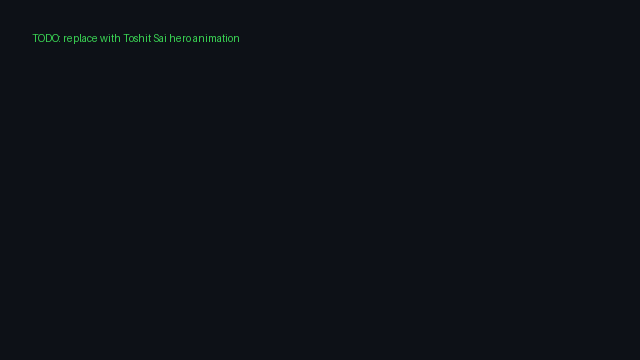

 712 contributions in 2026

<table><tr><td width="48%"></td><td width="52%"></td></tr></table>

# TOSHIT SAI GALAM

**AI Product Developer · Prompt Engineer · AI Video Creator**

_Building useful AI products and creative technology experiences._

    

## 👨‍💻 About Me
<table><tr><td width="58%">

### Who am I?
- 🎓 NIAT student building practical AI-powered products.
- 🤖 AI Product Developer focused on useful user experiences.
- ✍️ Prompt Engineer exploring reliable AI workflows.
- 🎬 AI Video Creator interested in creative technology.

> I build at the intersection of product thinking, AI, and creative technology.
</td><td width="42%">

<!-- TODO: replace this placeholder with a personal hero animation. -->

</td></tr></table>

## ⚡ Tech Stack
| Category | Technologies |
| --- | --- |
| Languages |    |
| Frontend |   |
| Backend |   |
| AI & Prompting |    |
| Tools |    |

## 🚀 Featured Projects
<table><tr><td width="50%">
### 🤖 [CourseForge AI](https://github.com/ToshitSai/courseforge-ai)
AI course generator turning topics into structured lessons, quizzes, and curated video resources.
`React` `Gemini API` `YouTube API` `Vercel`
- ✔ Structured learning content
- ✔ Quizzes and curated resources
</td><td width="50%">
### 🧠 [HireScope / Job Gem Grader](https://github.com/ToshitSai/job-gem-grader)
Resume and portfolio analyzer for role fit, keywords, strengths, and improvement areas.
`Next.js` `Puppeteer` `Claude API` `Serper API`
- ✔ Role-alignment review
- ✔ Actionable feedback
</td></tr><tr><td>
### 💌 [Greetly](https://github.com/ToshitSai/greetly)
Personalized greeting generator with tone controls, authentication, and saved message flows.
`React` `Flask` `Groq API` `JWT`
- ✔ Occasion and tone generation
- ✔ Accounts and saved messages
</td><td>
### 🎨 [Toshit Portfolio](https://github.com/ToshitSai/toshit-portfolio)
Animated personal portfolio with project showcases, case-study views, and contact routes.
`React` `TypeScript` `Vite` `Framer Motion`
- ✔ Animated case studies
- ✔ Contact and portfolio routes
</td></tr><tr><td>
### 🛡️ [Avengers: Doomsday](https://github.com/ToshitSai/Avengers-DoomsDay-)
Cinematic scroll experience with video scrubbing, WebGL atmosphere, particles, and story panels.
`Next.js` `React` `Three.js` `GSAP`
- ✔ Scroll-scrubbed sequences
- ✔ WebGL particles, fog, lightning, and portals
</td><td></td></tr></table>

## 🎯 Focus Areas
| 🤖 AI Products | ✍️ Prompt Engineering | 🎬 Creative Tech |
| --- | --- | --- |
| • Useful AI experiences • Product UX • AI workflows | • Reliable prompts • AI application design • Product thinking | • AI video creation • Animated interfaces • Immersive web experiences |

## 📊 GitHub Analytics

 
 
 

## 🤝 Connect With Me
If you’re building with AI, automation, or creative technology, connect through [LinkedIn](https://www.linkedin.com/in/toshit-sai-galam-177788276/) or [my portfolio](https://toshit-portfolio.vercel.app/).

